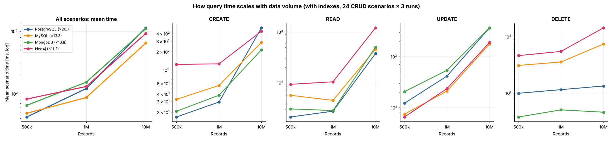

# Relational vs NoSQL: Database Performance Benchmark

A benchmark comparing four database engines (**PostgreSQL**, **MySQL**, **MongoDB**, **Neo4j**) on the same event-ticketing data model. Each engine runs 24 CRUD scenarios at three data volumes, with and without indexes.

> Team project (Advanced Database Technologies, Cracow University of Technology) by **Karolina Kokoszka** and **Aleksandra Frączek**.

     



## What it does

- **One domain model in four paradigms**: an event-booking system (users, events, venues, zones, seats, tickets, bookings, payments, reviews), mapped to relational tables, MongoDB documents and a Neo4j graph.
- **Synthetic data generator** at three scales: **small** (500k records), **medium** (1M) and **large** (10M).
- **24 CRUD scenarios**, 6 each for CREATE, READ, UPDATE and DELETE. They include JOINs, aggregations, rankings, cascading deletes, bulk updates and queries on semi-structured **JSON** fields.
- **Two phases** for every scenario, `without_indexes` and `with_indexes`. Each test runs at least 3 times and the times are averaged.
- **Query plan analysis** with `EXPLAIN` / `PROFILE` to explain why some queries get faster with indexes and others don't.
- **Automated reporting**: results are saved to CSV and summarised in HTML dashboards.

## Key findings

- **Hypothesis H2 confirmed**: performance differences between engines grow with data volume, and the curves diverge clearly between the medium and large datasets.
- Growth factor of the average scenario time from small to large (with indexes): **PostgreSQL ×26.7, MongoDB ×16.8, MySQL ×13.3, Neo4j ×11.2**. The PostgreSQL and MongoDB values are driven largely by one outlier scenario.
- The effect is strongest for CREATE, READ and UPDATE, and much weaker for DELETE.
- Indexes do not always help. When a filter on a JSON field matches about 33% of rows, PostgreSQL's planner chooses a sequential scan over the GIN index. MongoDB, by contrast, indexes nested BSON fields effectively (COLLSCAN changes to IXSCAN).

## Tech stack

Python 3.11 · Docker Compose · PostgreSQL 16 (`psycopg2`) · MySQL 8 (`mysql-connector-python`) · MongoDB 7 (`pymongo`) · Neo4j 5 (`neo4j` driver) · pandas

## Project structure

```
├── docker-compose.yml     # 4 database containers
├── db/                    # schema / init scripts per engine
│   ├── postgres/  mysql/  mongo/  neo4j/
├── generator/             # data generation and import into all 4 engines
│   ├── generate.py
│   ├── import_*.py
│   └── run_all.py
└── tests/
    ├── scenarios.py       # definitions of the 24 scenarios
    ├── crud_*.py          # scenario implementation per engine
    ├── run_tests.py       # benchmark runner + CSV/HTML reports
    └── run_explain.py     # query plan collection
```

## How to run

Requirements: Docker Desktop and Python 3.11+.

```bash
# 1. Start the databases
docker compose up -d

# 2. Install dependencies
pip install -r generator/requirements.txt pandas

# 3. Apply Neo4j constraints/indexes (PowerShell)
Get-Content .\db\neo4j\init.cypher | docker exec -i neo4j_events_container cypher-shell -u neo4j -p test1234

# 4. Generate data and import it into all engines
cd generator
python generate.py --size small          # small | medium | large
python run_all.py --size small --skip-generate

# 5. Run the benchmark and collect query plans
cd ../tests
python run_tests.py --phase both --size small
python run_explain.py --phase both
```

Results (CSV, HTML dashboards and EXPLAIN JSON files) are written to `tests/results/`.

> The credentials in `docker-compose.yml` are for local testing only.
